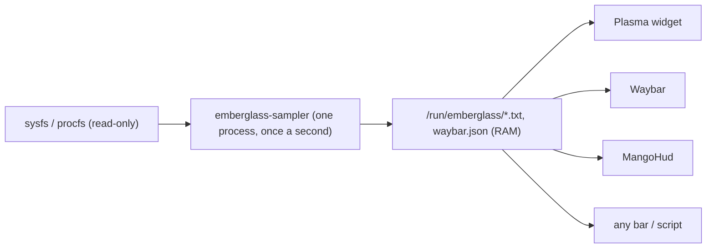

# emberglass

**Apple silicon sensors in your panel.** CPU / GPU temperatures, clocks, system power, RAM, battery and charge
limit for Macs running Linux, as a KDE Plasma widget, a Waybar module, a MangoHud line, or plain text for any bar.

```
panel:   87°  27.2 W  4.0 G

popup:   CPU P / E    87°C / 74°C
         GPU          70°C  idle
         CPU clock    4.46 / 2.70 GHz (P / E)
         CPU load     37%
         System power 27.2 W
         RAM          4.0 / 29.9 GB (13%)
         GPU memory   0.7 GB (part of RAM)
         Battery      79%, 7.0 W in (AC)
         Charge limit 80% (resumes at 75%)
```

**Only what your Mac really has is shown.** A sensor that does not exist or reads nothing (no SoC die zone on
your kernel, no GPU statistics, no power channel) is simply left out: no empty rows, no dashes, no `0°C`.

Works on any systemd distribution on an Apple silicon kernel (Asahi, Aurora Silicon): Arch Linux ARM / ALARM,
Fedora Asahi Remix, Omarchy, Pond, NixOS (flake module), and so on. Pure Python 3 standard library + POSIX shell;
nothing to compile.

- [Install](#install) · [Use](#use) · [Remove](#remove) · [How it works](#how-it-works) · [FAQ](#faq)

---

## Install

```sh
git clone https://github.com/m0d16l14n1/emberglass
cd emberglass
sudo ./install.sh
```

The installer copies the files, starts `emberglass.service`, and then puts the display where you will see it:

- **KDE Plasma** running → the *Emberglass* widget is added to your panel (next to the system tray).
- **Waybar** config found (`~/.config/waybar/config.jsonc` or `config`) → the module is added at the start of
  `modules-right`, a backup is kept, and Waybar is reloaded.

Skip that with `--no-desktop`. Other options: `--prefix DIR` (default `/usr/local`). Packagers:
`DESTDIR=/staging ./install.sh` installs into a staging root and starts nothing.

| Desktop / distro | What you get |
|---|---|
| KDE Plasma 6 (ALARM, Fedora KDE, ...) | panel widget, popup + tooltip with all values |
| Omarchy, Hyprland, Sway, niri + Waybar | Waybar module with tooltip and `cool` / `warm` / `hot` CSS classes |
| Pond (niri + Quickshell), other bars | `cat /run/emberglass/panel.txt` from any "run a command" widget, see below |
| Games | MangoHud line (`emberglass hud`) |
| NixOS | flake module below |

### NixOS

```nix
{
  inputs.emberglass.url = "github:m0d16l14n1/emberglass";
  outputs = { nixpkgs, emberglass, ... }: {
    nixosConfigurations.mymac = nixpkgs.lib.nixosSystem {
      modules = [
        emberglass.nixosModules.default
        { services.emberglass.enable = true; }
      ];
    };
  };
}
```

Then, as your user: `emberglass panel add` (Plasma) or `emberglass waybar add`. If your Waybar config is managed
by home-manager, add the module there instead (see [Waybar by hand](#waybar-by-hand)).

---

## Use

```sh
emberglass                  # what the sampler sees right now
emberglass watch            # the same, refreshed every second
emberglass panel add        # put the widget on your Plasma panel   (as your user, not root)
emberglass panel remove     # take it off
emberglass waybar add       # add the Waybar module (backup: config.jsonc.emberglass-backup)
emberglass waybar remove    # take it out again, your config is left as it was
emberglass hud              # the line to add to ~/.config/MangoHud/MangoHud.conf
```

Plasma by hand: right-click the panel → *Add Widgets* → *Emberglass*.

### Waybar by hand

```jsonc
"modules-right": ["custom/emberglass", ...],
"custom/emberglass": {
  "exec": "cat /run/emberglass/waybar.json",
  "return-type": "json",
  "interval": 2,
  "tooltip": true
}
```

```css
#custom-emberglass.warm { color: #e5a50a; }   /* 70-89 °C */
#custom-emberglass.hot  { color: #e01b24; }   /* 90 °C and up */
#custom-emberglass.paused { opacity: 0.5; }
```

### Any other bar (Pond / Quickshell, polybar, i3blocks, eww, ...)

Every output is a plain file, updated once a second; read it from anything that can run a command:

| File | Content |
|---|---|
| `/run/emberglass/panel.txt` | one short line: `87°  27.2 W  4.0 G` |
| `/run/emberglass/detail.txt` | the full popup text, one value per line |
| `/run/emberglass/hud.txt` | one line for a game HUD |
| `/run/emberglass/waybar.json` | `{"text", "tooltip", "class", "percentage"}` |

---

## Remove

```sh
sudo ./install.sh uninstall
```

Stops and removes the service, the CLI and the widget, takes the widget off your Plasma panel and the module out
of your Waybar config. NixOS: drop the module.

---

## How it works



**One reader.** Only the sampler touches the sensors; panels, HUDs and scripts read small files in RAM. Five
widgets cost the same as one, and nothing hits the SMC twice.

**Sources** (all optional; whatever is missing is left out):

| Value | Where it comes from |
|---|---|
| SoC die | thermal zone `soc-die-thermal` |
| CPU P / E, GPU temperature | `macsmc_hwmon`: the keys the device tree lists in `apple,soc-die-keys`, else every `Tp*` (P cores), `Te*` (E cores), `Tg*` (GPU) sensor; the hottest of each group |
| System power | SMC `Total System Power` |
| GPU clock | `agx_stats` `achieved_frequency_hz` while the pstate is valid, else "idle" |
| CPU clock, load | cpufreq policies (fastest cluster first), `/proc/stat` |
| RAM, swap | `/proc/meminfo` (used = MemTotal - MemAvailable, like `free`) |
| GPU memory | `gpu_memory` (unified memory: it is part of RAM, not extra) |
| Battery, charge limit | `power_supply` (capacity, AC, `charge_control_end_threshold`) |

**What is shown when something is missing.** A sensor is "missing" when it does not exist, cannot be read, or
reads an implausible value (0 or 150 °C and up). Then:

- its row is left out of the popup and the HUD (no dash, no `0°C`);
- the panel's one temperature is the SoC die if there is one, else the hottest CPU / GPU sensor, else no
  temperature at all;
- with no sensors at all, the panel shows RAM only. If even that is missing it says `No sensors found.`

**Stopped.** When the service stops (for example during a benchmark), the files switch to `paused` instead of
showing frozen numbers.

**Locked down.** The service runs with `DynamicUser`, no network, no capabilities, a read-only system and a 64 MB
memory cap; it can write only `/run/emberglass`.

---

## FAQ

**The widget says "Waiting for /run/emberglass"**: the service is not running. `systemctl status emberglass`.

**No temperatures at all**: your kernel has no `macsmc_hwmon` driver (or it is not loaded): `ls /sys/class/hwmon/*/name`.

**Why is there no "SoC die" row?** Your kernel does not register the die thermal zone. emberglass then uses the
hottest CPU / GPU sensor for the panel, which is what you want anyway.

**Battery charge limit shared with macOS?** See the sister project
[tidemark](https://github.com/m0d16l14n1/tidemark).

**Tests:** `sh tests/run.sh` runs the sampler on fake sysfs trees (full, no die zone, die reading 0, nothing at
all) and the Waybar editing on an Omarchy-style config. No root, touches nothing.

## License

GPL-2.0-or-later. See [LICENSE](LICENSE).
